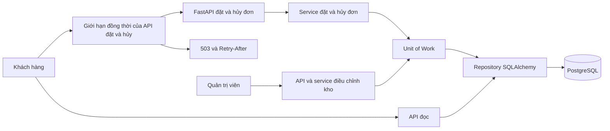

# Đặc tả Pha 2 hệ thống đặt hàng Flash Sale

**Phạm vi đã chốt** là xử lý đặt hàng đồng bộ trên FastAPI và PostgreSQL. Pha 2 gộp transaction cho từng nghiệp vụ, cập nhật kho theo chênh lệch, chống tạo đơn trùng, giới hạn đồng thời và bổ sung readiness. Nhóm có 4 người và 10 ngày làm việc cho bản nộp chính. Tuần thứ ba dành cho đo lại hoặc thử một phương án bổ sung dựa trên kết quả.

## 1. Hiện trạng và phạm vi

Pha 1 dùng FastAPI, service nghiệp vụ, repository SQLAlchemy và PostgreSQL. Phiên bản dùng làm mốc là `f75cb37`. Bộ test hiện có qua 47 ca và kiểm tra qua HTTP đã đi qua cả 15 thao tác API. Kết quả dưới đây được đo trên Docker cục bộ với PostgreSQL 16.16, một worker, một sản phẩm trong mỗi lượt và timeout đọc phía client 6 giây. Mỗi mức tải được chạy một lượt. [Kiến trúc hiện tại](README.md#2-kiến-trúc-hệ-thống)

| Ca thử tại máy | Kết quả quan sát | Yêu cầu Pha 2 |
| --- | --- | --- |
| 200 yêu cầu, 20 client, kho đầu 50 | 50 đơn, 150 phản hồi hết hàng, kho cuối 0 | Bảo toàn cơ chế cập nhật kho có điều kiện |
| Chủ động làm hỏng bước ghi đơn hoặc hoàn kho | Lỗi ghi đơn làm kho từ 10 xuống 8 dù không có đơn. Lỗi hoàn kho để đơn ở `CANCELLED` dù kho vẫn là 8. | Commit hoặc rollback toàn bộ nghiệp vụ |
| Admin nhập 5 món trong lúc khách mua 2 món, kho đầu 10 | Kho cuối 15, giá trị kỳ vọng 13 | Cập nhật tồn theo chênh lệch ngay trong DB |
| 8 yêu cầu mua cùng khóa | 8 đơn được ghi | Khóa gửi lại phải có hiệu lực trong DB |
| 1.000 yêu cầu, 50 client, kho đủ | 1.000 đơn, p95 khoảng 1,36 giây | Dùng làm tín hiệu để đo lại độ trễ trên Kaggle |
| 1.000 yêu cầu, 100 client, kho đủ | 1.000 timeout phía client, 30 đơn trong DB. Pool có 30 kết nối `idle in transaction`. Sau khi ngừng phát tải, API đọc và health vẫn timeout ở lần kiểm tra kế tiếp | Giới hạn tải đặt hàng và đo thời gian giữ kết nối |
| Dừng PostgreSQL | `/health` trả `200` cùng `database=disconnected` | Có endpoint readiness trả đúng trạng thái |

Các luồng còn lại của Pha 1 thuộc kiểm thử hồi quy. Số đo cục bộ là căn cứ chọn vấn đề. Bảng kết quả chính của Pha 2 sử dụng số đo mới trên Kaggle CPU. [Yêu cầu đề bài](DEBAI.md#gợi-ý-pha-2) · [Notebook Pha 1](notebooks/phase1_kaggle.ipynb)

## 2. Quyết định kiến trúc

| Phương án | Lợi ích | Đánh đổi và quyết định |
| --- | --- | --- |
| Xử lý đồng bộ với transaction cho từng nghiệp vụ | Một lần gọi trả kết quả cuối. Đơn và kho có thể cập nhật nguyên tử trong cùng PostgreSQL. | **Phương án của bản nộp chính.** Khi vượt sức xử lý, một phần yêu cầu nhận `503` và khách có thể thử lại. |
| Xử lý bất đồng bộ với hàng đợi bền vững và worker | Có thể tiếp nhận đợt tăng tải ngắn rồi xử lý dần. | Khách phải tra cứu kết quả sau khi nhận `202`. Hệ thống phải quản lý yêu cầu chờ và phục hồi worker. Chỉ thử ở tuần 3 nếu số đo cho thấy nhu cầu tiếp nhận đột biến còn cao và nghiệp vụ chấp nhận xác nhận đơn sau. |

FastAPI xác thực, phân quyền và ánh xạ lỗi ra HTTP. Service điều phối quy tắc đặt, hủy và điều chỉnh kho. Unit of Work mở một session cho mỗi thao tác ghi, cung cấp các repository dùng chung session và chịu trách nhiệm commit hoặc rollback. Các phương thức repository tham gia thao tác này thực hiện đọc, cập nhật hoặc flush trên session đó. Interface ở tầng domain hoặc service dùng kiểu dữ liệu nghiệp vụ. Adapter SQLAlchemy ở tầng infrastructure thực hiện thao tác DB. [Cách nối dependency hiện tại](app/api/dependencies.py) · [Interface repository hiện tại](app/domain/repositories.py)

### Ưu điểm và hạn chế

| Cải tiến | Ưu điểm | Hạn chế cần đánh giá |
| --- | --- | --- |
| Transaction đặt và hủy | Giữ trạng thái đơn và tồn kho nhất quán khi một bước ghi thất bại. | Lệnh ghi đồng thời trên cùng sản phẩm phải chờ khóa dòng. Thời gian giữ transaction ảnh hưởng trực tiếp đến khả năng xử lý ở sản phẩm bán chạy. |
| Điều chỉnh kho theo chênh lệch | Giữ hiệu lực của các lượt nhập, xuất và mua diễn ra đồng thời. | Lượt xuất kho sau có thể bị từ chối nếu một thao tác vừa dùng hết phần tồn khả dụng. |
| `Idempotency-Key` | Gửi lại sau khi mất phản hồi vẫn lấy được mã đơn đã tạo. | Tốn thêm thao tác ghi và dung lượng. Với khóa tùy chọn, hiệu lực chống trùng phụ thuộc vào việc client dùng lại cùng khóa. |
| Kết nối ngắn và giới hạn đồng thời | Giảm thời gian giữ kết nối và giúp API đọc tiếp tục phục vụ khi đặt hàng quá tải. | Giới hạn thấp có thể từ chối nhiều lượt mua. Giới hạn cao có thể làm pool nghẽn. Đánh giá p95 cùng số đơn hoàn tất, tỷ lệ timeout và tỷ lệ `503`. |
| `/ready` | Phát hiện mất kết nối DB và đo thời điểm phục hồi. | Mỗi lần thăm dò thêm một truy vấn. Truy vấn ngắn chỉ xác nhận kết nối DB tại thời điểm đo. Ca phục hồi cần thêm một lượt mua thành công. |

## 3. Yêu cầu chức năng và hợp đồng API

### FR-01 Đặt đơn và trừ kho

1. Giữ `POST /api/v1/orders` với body gồm `product_id` và `quantity`. Mỗi đơn mua một sản phẩm, với số lượng từ 1 đến 20.
2. Trong PostgreSQL, chỉ trừ kho nếu còn đủ hàng, sản phẩm đang `ACTIVE` và thời điểm cập nhật nằm trong khoảng mở bán. Tính theo UTC, bao gồm mốc bắt đầu và loại trừ mốc kết thúc. Mốc bỏ trống được xem là không có giới hạn tương ứng. Lấy đơn giá từ bản ghi đã cập nhật và lưu đơn giá, số lượng, tổng tiền vào đơn.
3. Tạo đơn `PENDING` và commit cùng lần trừ kho. Bước ghi thất bại phải rollback toàn bộ. Trả `201` sau khi commit thành công.
4. Giữ `400` cho lỗi nghiệp vụ như hết hàng, sản phẩm không mở bán hoặc số lượng vượt giới hạn. Giữ `422` cho dữ liệu bị schema từ chối và `401` cho yêu cầu thiếu hoặc sai thông tin xác thực trong điều kiện hệ thống phục vụ bình thường.

### FR-02 Hủy đơn và hoàn kho

1. Giữ `POST /api/v1/orders/{order_id}/cancel`. Chỉ chủ đơn có thể hủy. Đơn không tồn tại trả `404`. Người dùng khác nhận `403`.
2. Chỉ chuyển `PENDING` sang `CANCELLED`. Chuyển trạng thái có điều kiện và cộng kho trong cùng transaction. Hoàn kho thất bại thì rollback cả trạng thái.
3. Chủ đơn gọi lại khi đơn đã `CANCELLED` nhận `200` với đơn hiện tại. Nếu hai yêu cầu hủy đến đồng thời, chỉ yêu cầu chuyển trạng thái thành công được hoàn kho. Các trạng thái khác trả `400`.

### FR-03 Điều chỉnh tồn kho

Giữ `POST /api/v1/products/{product_id}/stock-adjustments` cho admin. Áp dụng `stock = stock + adjustment` trong DB với điều kiện tồn sau cập nhật nằm trong khoảng 0–1.000.000. Nếu lần cập nhật bị từ chối vì tồn không còn đủ hoặc vượt giới hạn, giữ phản hồi lỗi nghiệp vụ của Pha 1. Với `PATCH /api/v1/products/{product_id}`, chỉ ghi các trường thông tin được phép sửa và có mặt trong request. Nghiệm thu bằng ca admin nhập 5 món đồng thời với đơn mua 2 món từ kho 10. Kho sau cả hai thao tác là 13. [Quy tắc điều chỉnh kho Pha 1](app/services/product_service.py#L197)

### FR-04 Gửi lại yêu cầu tạo đơn

Client có thể gửi header `Idempotency-Key` khi gọi `POST /api/v1/orders`. Header tùy chọn để tương thích với client Pha 1. Client muốn thử lại an toàn phải tạo khóa trước lần gửi đầu và dùng lại khóa đó với cùng nội dung. Khóa phân biệt hoa thường, dài 1–128 ký tự và chấp nhận chữ ASCII, số, dấu chấm, gạch dưới, gạch ngang và dấu hai chấm.

| Trường hợp | Hành vi |
| --- | --- |
| Khóa mới, đặt đơn thành công | Trả `201`. Ghi kết quả gốc cùng transaction với đơn và kho. |
| Cùng người dùng, cùng khóa và cùng `product_id`, `quantity` | Trả lại `201` và nội dung lần tạo thành công đầu tiên, kể cả khi đơn sau đó đổi trạng thái. |
| Cùng người dùng, cùng khóa nhưng khác nội dung | Trả `409` với `{"detail":"IDEMPOTENCY_KEY_REUSED"}`. |
| Hai người dùng dùng cùng khóa | Xử lý độc lập theo phạm vi từng người dùng. |
| Khóa sai định dạng | Trả `422`. |
| Lượt đầu thất bại và rollback | Khóa được giải phóng cùng transaction. Lần gửi lại được đánh giá theo trạng thái tồn kho lúc đó. |

Thêm bảng `order_idempotency` bằng migration có phiên bản. Dùng khóa chính ghép `(user_id, idempotency_key)` và liên kết `order_id` với bảng `orders`. Lưu thêm `request_fingerprint`, `response_body` kiểu JSONB và `created_at`. Dấu vân tay là SHA-256 của chuỗi UTF-8 `<product_id>:<quantity>` sau validation, với UUID ở dạng chuẩn chữ thường và số lượng ở dạng số nguyên thập phân. Giữ bản ghi trong suốt thời gian thực hiện và đánh giá đồ án. Dùng cùng lệnh migration cho Docker và Kaggle trước khi nhận request. Migration chạy được trên DB mới và DB Pha 1 đã có dữ liệu.

Giao diện chung của người 1 và 2 là `create_order(user_id, product_id, quantity, *, idempotency_key=None)`. Trong một Unit of Work, thứ tự xử lý yêu cầu có khóa là **nhận khóa → trừ kho → tạo đơn → lưu kết quả gốc → commit**. Dùng ràng buộc duy nhất trong DB để xử lý hai yêu cầu đến cùng lúc. Request trùng khóa đọc bản ghi đã commit rồi so sánh dấu vân tay. Nếu bên ghi trước rollback, bên còn lại có thể ghi khóa và xử lý tiếp. Lượt gửi lại thành công trả cùng mã HTTP và dữ liệu phản hồi ban đầu.

### FR-05 Giới hạn tải và readiness

- Dùng **một giới hạn chung 16 suất mỗi worker** cho `POST /api/v1/orders` và `POST /api/v1/orders/{order_id}/cancel`. Thử lấy suất trước khi truy cập DB. Nếu có suất, yêu cầu tiếp tục qua xác thực và phân quyền. Giải phóng suất khi công việc kết thúc và tài nguyên DB đã được trả về, kể cả khi xảy ra lỗi.
- Mỗi yêu cầu giữ tối đa một kết nối cùng lúc. Kết thúc thao tác DB của bước xác thực trước khi mở transaction nghiệp vụ. Trả kết nối ngay khi thao tác DB kết thúc. Ghi số lần hết suất, số lần hết thời gian chờ pool, thời gian chờ lấy kết nối và thời gian giữ kết nối.
- Giữ một worker cho phép so sánh chính. Mặc định của C là 16 suất mỗi worker và thời gian chờ lấy kết nối là 1 giây. Cho phép chỉnh qua biến môi trường. Người 3 đặt giới hạn hữu hạn cho thời gian kết nối, chờ khóa và chạy câu lệnh, rồi bàn giao giá trị cho người 4 ghi vào cấu hình benchmark. Ghi lại cấu hình trước khi chạy bộ đo chính thức.
- Hết suất trả `503`, header `Retry-After: 1` và `{"detail":"ORDER_CAPACITY_EXCEEDED"}`. Yêu cầu bị từ chối ở bước này chưa chạy nghiệp vụ ghi. Lỗi hạ tầng DB tạm thời đã nhận diện trả `503`, header `Retry-After: 1` và `{"detail":"DB_TEMPORARILY_UNAVAILABLE"}`. Client thử lại thao tác tạo đơn với cùng `Idempotency-Key`.
- Thêm `GET /ready` với truy vấn DB ngắn và thời gian chờ hữu hạn. Trả `200` với `{"status":"ready"}` khi truy cập được DB. Trả `503` với `{"status":"not_ready"}` khi DB không sẵn sàng. Giữ `GET /health` để tương thích với client và notebook Pha 1.
- Xuất lại `openapi.json` và cập nhật README về header, mã `409`, `503`, hành vi hủy lặp và cách chạy.

## 4. Kịch bản chất lượng và nghiệm thu

Chạy các ca đúng/sai qua HTTP với PostgreSQL thật. Đúng dữ liệu là điều kiện bắt buộc ở mọi lượt có đối soát hợp lệ. Các ngưỡng hiệu năng là mục tiêu của bản C. Báo cáo từng lượt và dùng trung vị ba lượt ở cùng mức tải khi đánh giá ngưỡng p95 và tỷ lệ lỗi. Ghi rõ số liệu nếu có mục tiêu chưa đạt.

| Mã | Tác nhân và điều kiện | Phản ứng và thước đo |
| --- | --- | --- |
| QA-01 | Khách gửi 200 yêu cầu mua một món từ kho 50 với 8 client đồng thời | 50 lần tạo đơn, 150 phản hồi hết hàng, kho cuối 0. Kiểm tra cả kết quả HTTP và dữ liệu DB. |
| QA-02 | DB làm bước ghi đơn hoặc hoàn kho thất bại có kiểm soát | Sau khi yêu cầu kết thúc, dữ liệu đơn và kho giống trước thao tác. |
| QA-03 | 20 lượt gửi cùng khóa và nội dung qua tối đa 8 client. Sau commit, mô phỏng client chưa nhận kết quả rồi gửi lại | Một mã đơn duy nhất, kho chỉ giảm theo một đơn. Kiểm tra phản hồi gốc sau khi đơn đổi trạng thái, khóa khác nội dung trả `409`, khóa sai trả `422`, khóa dùng độc lập theo người dùng và lần gửi lại sau rollback. Hủy đồng thời chỉ hoàn kho một lần. |
| QA-04 | Admin nhập 5 món trong khi khách mua 2 món từ kho 10 | Hai thao tác thành công, DB có một đơn mua 2 món và kho cuối 13. |
| QA-05 | 1.000 yêu cầu mua ở 10 client, kho đủ hàng | 1.000 đơn duy nhất, sai lệch kho bằng 0. Mục tiêu p95 tối đa 500 ms và không có timeout. |
| QA-06 | Phát 1.000 yêu cầu mua ở 100 và 200 client, đồng thời gọi `GET /api/v1/products/{id}` mỗi 500 ms | Đơn được tiếp nhận tuân thủ quy tắc kho. Ca hết suất kiểm tra `503 ORDER_CAPACITY_EXCEEDED`, `Retry-After: 1` và khả năng trả lại suất sau lỗi. Mục tiêu trên Kaggle là timeout đặt hàng tối đa 1%, ít nhất 99% lượt thăm dò đọc thành công trong tải, và API đọc phục vụ trong vòng 5 giây từ khi ngừng phát tải mà không cần khởi động lại. |
| QA-07 | Dừng PostgreSQL rồi khởi động lại. Quan sát `/health` ở A, B và `/ready` ở C | Ở C, `/ready` trả `503` khi DB ngừng và trở lại `200` khi kết nối phục hồi. Ghi nhận thời gian phục hồi và kiểm tra một lượt mua thành công sau đó. |

Đối soát theo sản phẩm bằng công thức `kho cuối + tổng số lượng trong các đơn chưa hủy = kho đầu + tổng điều chỉnh kho đã commit`. Tính tổng trên dữ liệu của chính lượt thử. Khi client timeout, vẫn truy vấn DB để biết có đơn đã commit hay không.

## 5. Thí nghiệm trước và sau trên Kaggle CPU

### Các phiên bản

| Phiên bản | Nội dung so sánh |
| --- | --- |
| A | Commit Pha 1 `f75cb37`. |
| B | A cộng transaction, cập nhật kho theo chênh lệch và xử lý gửi lại. |
| C | B cộng rút ngắn vòng đời session, giới hạn tải và readiness. Đây là bản nộp chính. |

### Quy trình

1. Dùng cùng cấu hình Kaggle CPU cho A, B và C. Ưu tiên chạy trong cùng phiên. Cố định phiên bản Python, PostgreSQL, thư viện, số worker, dữ liệu, điều kiện làm nóng và timeout client. Lưu chính xác SHA và cấu hình riêng của từng bản.
2. Chạy 1.000 yêu cầu ở 10, 50, 100 và 200 client với một sản phẩm và kho đủ. Chạy thêm ca khan hàng QA-01. Lặp mỗi mức ba lần, tạo dữ liệu mới và khởi động backend mới cho mỗi lượt. Ca nhiều sản phẩm dùng cùng mức tải ở A, B và C để đánh giá ảnh hưởng của việc nhiều giao dịch ghi cùng một dòng.
3. Dùng timeout đọc 6 giây ở cả ba bản. Bộ phát tải chính gửi mỗi yêu cầu một lần. Kiểm thử gửi lại ở QA-03. Kiểm thử đọc khi quá tải dùng cùng lịch thăm dò giữa các phiên bản. Ghi số lượt thăm dò trong tải và thời gian từ khi ngừng phát tải đến lượt đọc thành công đầu tiên.
4. Chờ các request còn hoạt động trong thời gian có giới hạn, rồi đối soát DB. Nếu buộc dừng backend, lưu lý do và đánh dấu đối soát cuối chưa xác nhận. Giữ kết quả lượt lỗi cùng log để thấy khả năng phục hồi thực tế.
5. Xuất CSV từng request và CSV tổng hợp. Ghi riêng số `201`, hết hàng, `503` do giới hạn tải, `503` do hạ tầng, lỗi server khác và timeout. Báo cáo p50/p95/p99 trên toàn bộ lượt gửi và trên nhóm `201`, kèm số mẫu. Ghi số mã đơn duy nhất client nhận được, số đơn trong DB sau đối soát, tồn cuối và sai lệch kho.
6. Tính số đơn ghi nhận mỗi giây bằng số đơn duy nhất trong DB chia cho thời gian từ lúc bắt đầu phát đến lúc các request của lượt đo xử lý xong. Loại thời gian chuẩn bị dữ liệu và thời gian truy vấn đối soát khỏi phép tính. Chỉ báo cáo chỉ số này khi có thể xác nhận trạng thái DB cuối lượt. Kèm tỷ lệ yêu cầu nhận `201`, tỷ lệ từ chối và số lần pool hết kết nối khi có dữ liệu.

Biểu đồ nộp gồm **p95 theo số client**, **số đơn thực tế hoàn tất mỗi giây** và **phân bố kết quả thành công, hết hàng, từ chối do quá tải, lỗi và timeout**. Với mỗi quyết định kiến trúc, báo cáo ghi rõ số liệu nào cải thiện, chi phí phát sinh và kịch bản nào chưa đạt.

## 6. Phân công nhóm 4 người

Chọn repo nhóm sẽ nộp và dùng nhánh `phase2` làm nơi ghép PR. Tách nhánh công việc theo bốn phần dưới đây. Người 1 và 2 rà phần ghi dữ liệu của nhau. Người 3 bàn giao cấu hình và mã lỗi cho người 4 trước khi chạy bản C.

### Người 1 — Transaction và kho

1. Chuẩn bị Unit of Work, cấu trúc repository dùng chung session và giao diện `create_order` đã chốt. Bàn giao giao diện cho người 2 trong ngày 1–2.
2. Triển khai đặt đơn, hủy đơn, cập nhật kho theo chênh lệch và sửa cách ghi `PATCH` sản phẩm. Giữ quy tắc tính giá, trạng thái và quyền truy cập hiện có.
3. Cùng người 4 chạy QA-01, QA-02 và QA-04 trên PostgreSQL. Ưu tiên hai ca rollback và ca admin mua đồng thời trước khi ghép B.

**Bàn giao** PR FR-01 đến FR-03, giao diện Unit of Work và kết quả đối soát đơn, kho của ba ca trên.

### Người 2 — Chống trùng và hợp đồng API

1. Chuẩn bị migration, repository khóa và validation của `Idempotency-Key` song song với người 1. Dùng Unit of Work chung để ghép nhận khóa và lưu phản hồi.
2. Đưa ra một lệnh migration dùng được cho Docker và Kaggle. Kiểm tra giữ dữ liệu Pha 1 sau khi migration.
3. Cùng người 4 chạy QA-03. Cập nhật README và xuất lại OpenAPI cho thay đổi đặt, hủy và gửi lại trong B. Sau khi ghép FR-05, dùng mã lỗi và cấu hình của người 3 để cập nhật hợp đồng `503` và readiness trước khi chốt C.

**Bàn giao** PR FR-04, migration chạy được trên hai loại DB và mô tả API khớp bản C.

### Người 3 — Kết nối, giới hạn tải và readiness

1. Tái hiện nghẽn pool trên A từ log và trạng thái PostgreSQL. Chuẩn bị cơ chế đo thời gian chờ, giữ kết nối và số lần hết suất.
2. Triển khai trả kết nối sớm, giới hạn 16 suất, hai loại `503` và `/ready`. Kiểm tra yêu cầu kết thúc bình thường hoặc gặp lỗi đều trả lại suất. Ghép thay đổi sau khi đã lưu SHA của B.
3. Cùng người 4 chạy QA-06 và QA-07. Bàn giao cấu hình worker, pool và timeout dưới dạng có thể dùng lại trong notebook.

**Bàn giao** PR FR-05, cấu hình bản C và hướng dẫn đọc log để phân biệt giới hạn tải với lỗi hạ tầng.

### Người 4 — Kiểm thử, Kaggle và báo cáo

1. Ngay ngày 1 xác nhận môi trường Kaggle CPU và chạy A theo SHA. Chuẩn bị dữ liệu tách riêng từng lượt và các ca gây lỗi ghi có kiểm soát.
2. Viết và chạy QA-01 đến QA-07 cùng các thành viên. Đối chiếu số đơn và kho trong PostgreSQL, kể cả khi phía client timeout. Chạy hồi quy và kiểm tra triển khai từ DB trống lẫn DB Pha 1.
3. Chạy A/B/C trên cùng cấu hình, lưu CSV và log. Dựng biểu đồ, ghi các đánh đổi và chuẩn bị demo rollback, gửi lại và quá tải.

**Bàn giao** notebook tái lập theo SHA, bộ kiểm thử tích hợp, dữ liệu kết quả và báo cáo trước–sau.

### Mốc ghép công việc

| Mốc | Phần phải hoàn tất |
| --- | --- |
| **Ngày 1–2** | Tạo nhánh công việc. Người 1 bàn giao interface cho người 2. Người 3 đo nghẽn pool trên A và người 4 xác nhận notebook chạy A được trên Kaggle. |
| **Ngày 3–5** | Ghép PR transaction trước, PR chống trùng sau. Chạy QA-01 đến QA-04 rồi lưu SHA của B. |
| **Ngày 6–8** | Ghép PR quản lý session, giới hạn tải và readiness lên B. Đồng bộ README và OpenAPI. Cố định cấu hình, lưu SHA của C rồi chạy đủ ma trận A/B/C trên cùng Kaggle CPU. |
| **Ngày 9–10** | Chạy hồi quy, rà số liệu, ghép báo cáo và duyệt demo. Ghi rõ mục tiêu nào đạt và đánh đổi nào còn lại. |
| **Tuần 3 nếu có** | Lặp lại ca dao động lớn và đánh giá ảnh hưởng khi tải phân bố trên nhiều sản phẩm. Chỉ làm nguyên mẫu hàng đợi nếu còn một vấn đề đo được cần xử lý. |

## 7. Điều kiện bàn giao

- 47 ca hồi quy hiện có vẫn qua hoặc được cập nhật phù hợp với hành vi mới đã đặc tả. Các ca tích hợp PostgreSQL chứng minh đặt, hủy, điều chỉnh kho và gửi lại đúng dưới tải đồng thời.
- Docker Compose khởi động được từ DB trống. Migration tạo bảng mới trên DB Pha 1 và giữ được dữ liệu đơn, sản phẩm, người dùng.
- README và OpenAPI khớp với API chạy thật. Nhóm có commit cho A, B, C cùng hướng dẫn chạy các ca chính.
- Báo cáo có sơ đồ kiến trúc, phương án đã cân nhắc, dữ liệu môi trường Kaggle, CSV, biểu đồ và kết quả đối soát. Demo trình bày được một ca rollback, một ca gửi lại và một ca đặt hàng quá tải khi API đọc vẫn phục vụ.
