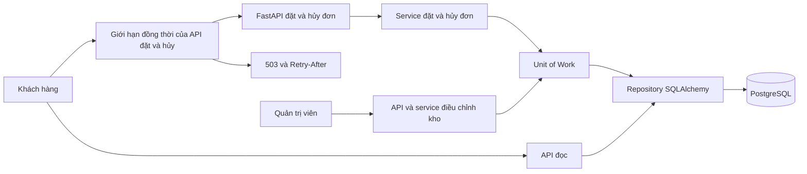

# Đặc tả Pha 2 hệ thống đặt hàng Flash Sale

**Mục tiêu** là giữ đơn hàng và tồn kho nhất quán khi xử lý đồng thời, cho phép gửi lại yêu cầu sau timeout và duy trì khả năng phục vụ khi luồng đặt hàng quá tải. Nhóm có 4 người và 10 ngày làm việc cho phạm vi chính. Tuần thứ ba dành cho đo lại hoặc thử một phương án kiến trúc bổ sung nếu có căn cứ từ số liệu.

## 1. Hiện trạng và phạm vi

Pha 1 dùng FastAPI, service nghiệp vụ, repository SQLAlchemy và PostgreSQL. Phiên bản dùng làm mốc là `f75cb37`. Bộ test hiện có qua 47 ca và kiểm tra qua HTTP đã đi qua cả 15 thao tác API. Kết quả dưới đây được đo trên Docker cục bộ với PostgreSQL 16.16, một worker, một sản phẩm trong mỗi lượt và timeout đọc phía client 6 giây. Mỗi mức tải được chạy một lượt. [Kiến trúc hiện tại](README.md#2-kiến-trúc-hệ-thống)

| Ca thử tại máy | Kết quả quan sát | Yêu cầu Pha 2 |
| --- | --- | --- |
| 200 yêu cầu, 20 client, kho đầu 50 | 50 đơn, 150 phản hồi hết hàng, kho cuối 0 | Bảo toàn cơ chế cập nhật kho có điều kiện |
| Chủ động làm hỏng bước ghi đơn hoặc hoàn kho | Kho giảm mà không có đơn, hoặc đơn đã hủy mà kho chưa được hoàn | Commit hoặc rollback toàn bộ nghiệp vụ |
| Admin nhập 5 món trong lúc khách mua 2 món, kho đầu 10 | Kho cuối 15, giá trị kỳ vọng 13 | Cập nhật tồn theo chênh lệch ngay trong DB |
| 8 yêu cầu mua cùng khóa | 8 đơn được ghi | Khóa gửi lại phải có hiệu lực trong DB |
| 1.000 yêu cầu, 50 client, kho đủ | 1.000 đơn, p95 khoảng 1,36 giây | Dùng làm tín hiệu để đo lại độ trễ trên Kaggle |
| 1.000 yêu cầu, 100 client, kho đủ | 1.000 timeout phía client, 30 đơn trong DB. Pool có 30 kết nối `idle in transaction`. Sau khi ngừng phát tải, API đọc và health vẫn timeout ở lần kiểm tra kế tiếp | Giới hạn tải đặt hàng và đo thời gian giữ kết nối |
| Dừng PostgreSQL | `/health` trả `200` cùng `database=disconnected` | Có endpoint readiness trả đúng trạng thái |

Phạm vi chính gồm tạo và hủy đơn, điều chỉnh kho, xử lý gửi lại, giới hạn đồng thời, readiness và đánh giá trước–sau. Các luồng còn lại của Pha 1 thuộc kiểm thử hồi quy. Số đo cục bộ là căn cứ chọn vấn đề. Bảng kết quả chính của Pha 2 sử dụng số đo mới trên Kaggle CPU. [Yêu cầu đề bài](DEBAI.md#gợi-ý-pha-2) · [Notebook Pha 1](notebooks/phase1_kaggle.ipynb)

## 2. Quyết định kiến trúc

| Phương án | Lợi ích | Đánh đổi và quyết định |
| --- | --- | --- |
| Xử lý đồng bộ với transaction cho từng nghiệp vụ | Một lần gọi trả kết quả cuối. Đơn và kho có thể cập nhật nguyên tử trong cùng PostgreSQL. | **Chọn cho phạm vi chính** và bổ sung giới hạn đồng thời. Khi vượt sức xử lý, một phần yêu cầu nhận `503` và khách có thể thử lại. |
| Xử lý bất đồng bộ với hàng đợi bền vững và worker | Có thể tiếp nhận đợt tăng tải ngắn rồi xử lý dần. | Khách phải tra cứu kết quả sau khi nhận `202`. Hệ thống phải quản lý yêu cầu chờ và phục hồi worker. Chỉ thử ở tuần 3 nếu số đo cho thấy nhu cầu tiếp nhận đột biến còn cao và nghiệp vụ chấp nhận xác nhận đơn sau. |

FastAPI xác thực, phân quyền và ánh xạ lỗi ra HTTP. Service quyết định quy tắc đặt, hủy và điều chỉnh kho. Unit of Work mở một session cho thao tác ghi, cung cấp các repository dùng chung session và chịu trách nhiệm commit hoặc rollback. Interface nghiệp vụ ở tầng domain hoặc service dùng kiểu dữ liệu nghiệp vụ. Adapter SQLAlchemy ở tầng infrastructure thực hiện thao tác DB. [Cách nối dependency hiện tại](app/api/dependencies.py) · [Interface repository hiện tại](app/domain/repositories.py)

## 3. Yêu cầu chức năng và hợp đồng API

### FR-01 Đặt đơn và trừ kho

1. Giữ `POST /api/v1/orders` với body gồm `product_id` và `quantity`. Kiểm tra quyền truy cập, số lượng từ 1 đến 20 và điều kiện sản phẩm đang mở bán.
2. Cập nhật kho trong PostgreSQL với điều kiện còn đủ hàng và sản phẩm đủ điều kiện bán tại thời điểm xử lý. Lấy giá dùng để tạo đơn từ bản ghi được cập nhật. Đơn ghi lại đơn giá, số lượng và tổng tiền tại lúc mua.
3. Tạo đơn `PENDING` và commit cùng lần trừ kho. Bước ghi thất bại phải rollback toàn bộ. Trả `201` sau khi commit thành công.
4. Giữ `400` cho lỗi nghiệp vụ như hết hàng, sản phẩm không mở bán hoặc số lượng vượt giới hạn. Giữ `422` cho dữ liệu bị schema từ chối và `401` cho yêu cầu thiếu hoặc sai thông tin xác thực trong điều kiện hệ thống phục vụ bình thường.

### FR-02 Hủy đơn và hoàn kho

1. Giữ `POST /api/v1/orders/{order_id}/cancel`. Chỉ chủ đơn có thể hủy. Đơn không tồn tại trả `404`. Người dùng khác nhận `403`.
2. Chỉ chuyển `PENDING` sang `CANCELLED`. Chuyển trạng thái có điều kiện và cộng kho trong cùng transaction. Hoàn kho thất bại thì rollback cả trạng thái.
3. Chủ đơn gọi lại khi đơn đã `CANCELLED` nhận `200` với đơn hiện tại. Nếu hai yêu cầu hủy đến đồng thời, chỉ yêu cầu chuyển trạng thái thành công được hoàn kho. Các trạng thái khác trả `400`.

### FR-03 Điều chỉnh tồn kho

Giữ `POST /api/v1/products/{product_id}/stock-adjustments` cho admin. Áp dụng `stock = stock + adjustment` trong DB với điều kiện tồn sau cập nhật hợp lệ theo quy tắc hiện tại. Giữ `PATCH /api/v1/products/{product_id}` cho thông tin sản phẩm và chỉ ghi các trường được phép sửa trong request. Nghiệm thu bằng ca admin nhập 5 món đồng thời với đơn mua 2 món từ kho 10. Kho sau cả hai thao tác là 13.

### FR-04 Gửi lại yêu cầu tạo đơn

Client có thể gửi header `Idempotency-Key` khi gọi `POST /api/v1/orders`. Header tùy chọn để tương thích với client Pha 1. Client muốn thử lại an toàn phải tạo khóa trước lần gửi đầu và dùng lại khóa đó với cùng nội dung. Khóa phân biệt hoa thường, dài 1–128 ký tự và chấp nhận chữ ASCII, số, dấu chấm, gạch dưới, gạch ngang và dấu hai chấm.

| Trường hợp | Hành vi |
| --- | --- |
| Khóa mới, đặt đơn thành công | Trả `201`. Ghi kết quả gốc cùng transaction với đơn và kho. |
| Cùng người dùng, cùng khóa và cùng `product_id`, `quantity` | Trả lại `201` và nội dung lần tạo thành công đầu tiên, kể cả khi đơn sau đó đổi trạng thái. |
| Cùng người dùng, cùng khóa nhưng khác nội dung | Trả `409` với thông báo khóa đã gắn với yêu cầu khác. |
| Hai người dùng dùng cùng khóa | Xử lý độc lập theo phạm vi từng người dùng. |
| Khóa sai định dạng | Trả `422`. |
| Lượt đầu thất bại và rollback | Khóa được giải phóng cùng transaction. Lần gửi lại được đánh giá theo trạng thái tồn kho lúc đó. |

Thêm bảng `order_idempotency` bằng migration có phiên bản. Dùng khóa chính ghép `(user_id, idempotency_key)` và liên kết `order_id` với bảng `orders`. Lưu thêm `request_fingerprint`, `response_body` kiểu JSONB và `created_at`. Dấu vân tay là SHA-256 của UUID sản phẩm chuẩn hóa và số lượng đã qua validation. Giữ bản ghi trong suốt thời gian thực hiện và đánh giá đồ án.

Trong transaction, thử ghi khóa trước khi trừ kho. Request ghi được khóa có quyền tạo đơn và phải gắn mã đơn cùng phản hồi gốc trước khi commit. Request trùng khóa đọc bản ghi đã commit rồi so sánh dấu vân tay. Nếu bên ghi trước rollback, bên còn lại có thể ghi khóa và xử lý tiếp. Nếu hết thời gian chờ kết nối hoặc khóa, trả lỗi tạm thời để client thử lại với cùng khóa.

### FR-05 Giới hạn tải và readiness

- Áp dụng giới hạn chung cho hai thao tác ghi đặt và hủy đơn. Kiểm tra giới hạn trước khi lấy kết nối DB và giải phóng suất xử lý khi request kết thúc hoặc gặp lỗi. Các thao tác được tiếp nhận vẫn chạy xác thực và phân quyền hiện có.
- Khi hết suất, trả `503 Service Unavailable` và header `Retry-After: 1` theo cấu hình thử ban đầu. Khách gọi lại tạo đơn với cùng `Idempotency-Key`. Lượt bị từ chối tại bước tiếp nhận không thay đổi đơn hoặc kho.
- Dùng một worker cho phép so sánh chính. Bắt đầu thử với tối đa 16 thao tác đặt hoặc hủy đang xử lý mỗi worker. Cấu hình giá trị từ môi trường và cố định trước khi đo bản cuối. Đo thời gian chờ và giữ kết nối để chọn ngân sách phù hợp cho API đọc và ghi.
- Đặt thời gian chờ lấy kết nối và thực thi câu lệnh DB hữu hạn. Ghi log có cấu trúc cho lỗi pool, lỗi DB và yêu cầu bị từ chối. Trả lỗi tạm thời có kiểm soát với sự cố hạ tầng đã nhận diện. Mọi thao tác có transaction phải rollback và trả lại kết nối khi kết thúc.
- Thêm `GET /ready` dùng truy vấn DB ngắn với thời gian chờ hữu hạn. Trả `200` khi DB truy cập được và `503` khi DB không sẵn sàng. Giữ `GET /health` cho client và notebook cũ.
- Xuất lại `openapi.json` và cập nhật README về header, mã `409`, `503`, hành vi hủy lặp và cách chạy.

## 4. Kịch bản chất lượng và nghiệm thu

Các ca đúng/sai chạy trên PostgreSQL qua HTTP. Các ngưỡng hiệu năng bên dưới là mục tiêu đề xuất cho phép đo Kaggle. Nhóm chốt ngưỡng sau khi chạy mốc Pha 1 và trước khi xem kết quả các bản cải tiến.

| Mã | Tác nhân và điều kiện | Phản ứng và thước đo |
| --- | --- | --- |
| QA-01 | Khách gửi 200 yêu cầu mua một món từ kho 50 với 8 client đồng thời | 50 lần tạo đơn, 150 phản hồi hết hàng, kho cuối 0. Kiểm tra cả kết quả HTTP và dữ liệu DB. |
| QA-02 | DB làm bước ghi đơn hoặc hoàn kho thất bại có kiểm soát | Sau khi yêu cầu kết thúc, dữ liệu đơn và kho giống trước thao tác. |
| QA-03 | 20 lượt gửi cùng khóa và nội dung qua tối đa 8 client. Sau commit, mô phỏng client chưa nhận kết quả rồi gửi lại | Một mã đơn duy nhất, kho chỉ giảm theo một đơn. Kiểm tra thêm cùng khóa khác nội dung trả `409`, khóa sai định dạng trả `422`, hai người dùng có thể dùng cùng khóa, và lần gửi lại được xử lý sau rollback. Hủy đồng thời chỉ hoàn kho một lần. |
| QA-04 | Admin nhập 5 món trong khi khách mua 2 món từ kho 10 | Hai thao tác thành công, DB có một đơn mua 2 món và kho cuối 13. |
| QA-05 | 1.000 yêu cầu mua ở 10 client, kho đủ hàng | 1.000 đơn duy nhất, sai lệch kho bằng 0. Mục tiêu p95 tối đa 500 ms và không có timeout. |
| QA-06 | Phát 1.000 yêu cầu mua ở 100 và 200 client, đồng thời gọi `GET /products/{id}` mỗi 500 ms | Đơn được tiếp nhận tuân thủ quy tắc kho. Yêu cầu vượt giới hạn có thể nhận `503`. Mục tiêu timeout đặt hàng tối đa 1%, ít nhất 99% lượt thăm dò đọc thành công, và API đọc phục vụ trong vòng 5 giây từ khi ngừng phát tải mà không cần khởi động lại. |
| QA-07 | Dừng PostgreSQL rồi khởi động lại. Quan sát `/health` ở A, B và `/ready` ở C | Ở C, `/ready` trả `503` khi DB ngừng và trở lại `200` khi kết nối phục hồi. Ghi nhận thời gian phục hồi và kiểm tra một lượt mua thành công sau đó. |

Đối soát theo sản phẩm bằng công thức `kho cuối + tổng số lượng trong các đơn chưa hủy = kho đầu + tổng điều chỉnh kho đã commit`. Tính tổng trên dữ liệu của chính lượt thử. Khi client timeout, vẫn truy vấn DB để biết có đơn đã commit hay không.

## 5. Thí nghiệm trước và sau trên Kaggle CPU

### Các phiên bản

| Phiên bản | Nội dung so sánh |
| --- | --- |
| A | Commit Pha 1 `f75cb37`. |
| B | A cộng transaction, cập nhật kho theo chênh lệch và xử lý gửi lại. |
| C | B cộng rút ngắn vòng đời session, giới hạn tải và readiness. Đây là bản nộp chính. |

### Quy trình

1. Dùng cùng cấu hình Kaggle CPU cho A, B và C. Ưu tiên chạy trong cùng phiên. Cố định phiên bản Python, PostgreSQL, thư viện, số worker, dữ liệu, điều kiện làm nóng và timeout client. Lưu chính xác SHA và cấu hình riêng của từng bản.
2. Chạy 1.000 yêu cầu ở 10, 50, 100 và 200 client với một sản phẩm và kho đủ. Chạy thêm ca khan hàng QA-01. Lặp mỗi mức ít nhất ba lần, tạo dữ liệu mới và khởi động backend mới cho mỗi lượt. Chạy lại 50 hoặc 100 client với nhiều sản phẩm để xem ảnh hưởng của việc nhiều giao dịch ghi cùng một dòng.
3. Dùng timeout đọc 6 giây ở cả ba bản. Bộ phát tải chính không tự thử lại để số liệu thể hiện phản ứng của từng bản với cùng đầu vào. Kiểm thử gửi lại ở QA-03. Kiểm thử đọc khi quá tải dùng cùng lịch thăm dò giữa các phiên bản.
4. Chờ các request còn hoạt động trong thời gian có giới hạn, rồi đối soát DB. Nếu buộc dừng backend, lưu lý do và đánh dấu đối soát cuối chưa xác nhận. Giữ kết quả lượt lỗi cùng log để thấy khả năng phục hồi thực tế.
5. Xuất CSV từng request và CSV tổng hợp. Lưu số `201`, hết hàng, `503` chủ động, lỗi server khác, timeout, số đơn duy nhất trong DB, tồn cuối và sai lệch kho. Báo cáo p50/p95/p99 trên toàn bộ lượt gửi và trên tập thành công, kèm số mẫu. Tính throughput bằng số đơn duy nhất hoàn tất mỗi giây và báo cáo kèm tỷ lệ yêu cầu nhận kết quả đặt hàng. Lưu số lần pool hết kết nối và thời gian phục hồi sau quá tải.

Biểu đồ nộp gồm **p95 theo số client**, **số đơn thực tế hoàn tất mỗi giây** và **phân bố kết quả thành công, hết hàng, từ chối do quá tải, lỗi và timeout**. Với mỗi quyết định kiến trúc, báo cáo ghi rõ số liệu nào cải thiện, chi phí phát sinh và kịch bản nào chưa đạt.

## 6. Phân công nhóm 4 người

| Người | Nhiệm vụ tuần 1 | Nhiệm vụ tuần 2 | Đầu ra và nghiệm thu |
| --- | --- | --- | --- |
| **Người 1 — Transaction và kho** | Ngày 1 chốt interface Unit of Work với người 2 và 3. Ngày 2–4 sửa luồng đặt, hủy và cập nhật tồn theo chênh lệch. Ngày 5 ghép luồng nghiệp vụ với phần chống trùng. | Xử lý phát hiện từ test tích hợp, rà rollback và tương tác giữa đặt, hủy, cập nhật sản phẩm. | PR triển khai FR-01 đến FR-03. QA-01, QA-02 và QA-04 đạt trên PostgreSQL. Bàn giao mã thao tác đặt đơn dùng chung session cho người 2. |
| **Người 2 — Chống trùng và hợp đồng API** | Chốt mã HTTP và quy tắc khóa ngày 1. Viết migration và repository chống trùng ngày 2–3. Tích hợp lưu phản hồi gốc cùng transaction ngày 4–5. | Kiểm tra đồng thời, khóa khác nội dung, lỗi rollback và chạy migration trên DB đã có dữ liệu. Cùng người 3 cập nhật OpenAPI và README. | PR triển khai FR-04. QA-03 đạt. Bàn giao cách thử lại cho người 4 để dựng demo. |
| **Người 3 — Chịu tải và readiness** | Thêm đo thời gian chờ, giữ kết nối và số lần cạn pool. Tái hiện nghẽn ở mốc A, thử giới hạn đồng thời và đo API đọc. Làm `/ready` và chuẩn bị cấu hình thời gian chờ. | Ghép thay đổi trên B để tạo C. Chốt cấu hình trước lượt benchmark chính và hỗ trợ phân tích log. | PR triển khai FR-05. QA-06 và QA-07 có số đo. Bàn giao file cấu hình cùng hướng dẫn phân biệt `503` chủ động và lỗi hạ tầng. |
| **Người 4 — Kiểm thử, Kaggle và báo cáo** | Chốt ma trận nghiệm thu. Viết ca HTTP/PostgreSQL cho lỗi giữa chừng, tranh mua, gửi lặp và admin điều chỉnh kho. Cố định SHA trong notebook và chạy baseline Kaggle. | Chạy B và C, lưu kết quả thô, dựng biểu đồ và tổng hợp các quyết định, đánh đổi. Chuẩn bị trình diễn và đối chiếu điều kiện nghiệm thu. | Notebook chạy lại được, kết quả theo A/B/C, biểu đồ và kịch bản demo. Từng kết luận có ca test hoặc số đo tương ứng. |

### Mốc ghép công việc

| Mốc | Phần phải hoàn tất |
| --- | --- |
| **Ngày 1–2** | Chốt interface transaction, hành vi API, cách tạo dữ liệu và cách gây lỗi trong DB thử nghiệm. Chạy mốc A trên Kaggle sớm để phát hiện vấn đề môi trường. |
| **Ngày 3–5** | Ghép transaction và chống trùng, chốt commit B để đo. Các ca sai kho và đơn trùng tái hiện được trên A và được kiểm tra lại trên B. |
| **Ngày 6–8** | Ghép quản lý session, giới hạn tải và readiness lên B. Cố định cấu hình và commit C. Chạy đủ ma trận A/B/C với cùng cấu hình Kaggle CPU. |
| **Ngày 9–10** | Chạy hồi quy, rà số liệu, ghép báo cáo và duyệt demo. Ghi rõ mục tiêu nào đạt và đánh đổi nào còn lại. |
| **Tuần 3 nếu có** | Lặp lại ca dao động lớn và đánh giá ảnh hưởng khi tải phân bố trên nhiều sản phẩm. Chỉ làm nguyên mẫu hàng đợi nếu còn một vấn đề đo được cần xử lý. |

## 7. Điều kiện bàn giao

- 47 ca hồi quy hiện có vẫn qua hoặc được cập nhật phù hợp với hành vi mới đã đặc tả. Các ca tích hợp PostgreSQL chứng minh đặt, hủy, điều chỉnh kho và gửi lại đúng dưới tải đồng thời.
- Docker Compose khởi động được từ DB trống. Migration tạo bảng mới trên DB Pha 1 và giữ được dữ liệu đơn, sản phẩm, người dùng.
- README và OpenAPI khớp với API chạy thật. Nhóm có commit cho A, B, C cùng hướng dẫn chạy các ca chính.
- Báo cáo có sơ đồ kiến trúc, phương án đã cân nhắc, dữ liệu môi trường Kaggle, CSV, biểu đồ và kết quả đối soát. Demo trình bày được một ca rollback, một ca gửi lại và một ca đặt hàng quá tải khi API đọc vẫn phục vụ.
